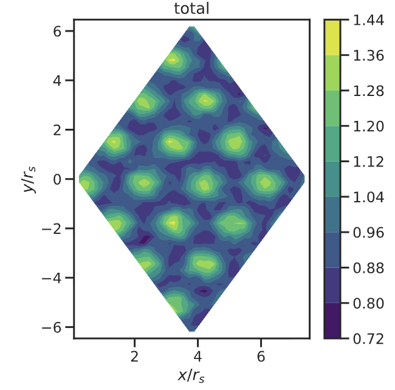

# fvmc

Variational Monte Carlo for fermions in first quantization, reduced to the
inference path: it loads a wavefunction and samples it to compute
local energies and observables. 

## Requirements

Python **3.11** 
The pinned versions in `requirements.txt` are the exact ones
used for the published runs.

| package | version | why |
| --- | --- | --- |
| `jax`, `jaxlib` | 0.4.30 | array library and autodiff |
| `numpy` | 1.26.4 | |
| `flax` | 0.8.5 | wavefunction modules |
| `ml-collections` | 0.1.1 | config objects |
| `PyYAML` | 6.0 | reads/writes `hparams.yaml` |
| `npy-append-array` | 0.9.16 | streams the MC trajectory to disk |
| `h5py` | 3.11.0 | reads the Hartree–Fock input files |
| `fwdlap` | 0.1.4 | forward-mode Laplacian for the kinetic energy |
| `matplotlib`, `scipy` | 3.8.4, 1.13.0 | plotting only |

`fwdlap` is **not on PyPI** and is installed from GitHub, so `git` and network
access are needed. 

## Install

```bash
python3.11 -m venv fvmc-env
source fvmc-env/bin/activate
pip install --upgrade pip
pip install -r requirements.txt
pip install -e . --no-deps
```

This gives a **CPU-only** JAX, which is enough to run the dummy example. For a
GPU (CUDA 12), add afterwards:

```bash
pip install --upgrade "jax[cuda12]==0.4.30"
```

To switch between running on CPU or GPU after installing jax[cuda12], run:

```bash
export JAX_PLATFORMS=cpu #switches to CPU
export JAX_PLATFORMS=cuda #switches to GPU
```

Check the install:

```bash
python -c "import jax, fvmc; print(jax.__version__, jax.default_backend())"
```

## Run

All the user side scripts are found in `examples/AHC-inference/`. With no
arguments, run_inference.py runs a small nine-electron example to verify the pipeline works:

```bash
cd examples/AHC-inference
python run_inference.py
```

The checkpoints of the optimized wave-functions as well as the helper input files specifying the simulation cell and Hamiltonian are not contained in this repository. Instead, they are distributed separately, and belong in `examples/AHC-inference/checkpoints/ 
To run one of the published simulation, after downloading and copying the data files into this directory, follow the below steps.

Give the electron number, density
parameter, lambda and phase:

```bash
python run_inference.py --nelec 16 --rs 8 --lam 0.72 --phase ahc
```

Running this command outputs the total energy, and the published total energy as reference. For computing and plotting observables, see below under "Observables".

`--ansatz` selects the wavefunction within a phase: `nn` (default) is the
neural backflow, `nn_sbf` the spin dependent (spinor) backflow, where available (see simulation grid printed by `--help`)

```bash
python run_inference.py --nelec 16 --rs 6 --lam 0.72 --phase liq --ansatz nn_sbf
```

`--twisted` picks the twisted-boundary variant of a run instead of the Gamma
point one. It is a plain switch: which twist is used is recorded in the
catalogue, not chosen on the command line.

```bash
python run_inference.py --nelec 16 --rs 6 --lam 0.72 --phase liq --twisted
```

To run a N=36 simulation, specify `--nelec 36`, e.g. running the following:

```bash
python run_inference.py --nelec 36 --rs 18 --lam 0.72 --phase ahc
```

`simulations.csv` lists every available combination together with the energy
it should reproduce. `python run_inference.py --help` prints the same
information as a grid. An unavailable combination is rejected with that grid
and a non-zero exit status.

Results are written to `outputs/`. The run prints its own energy next to the
published reference value.

The chain length and the trajectory output are set with:

| flag | default | meaning |
| --- | --- | --- |
| `--iterations` | 500 (5 for the dummy example) | sampling iterations averaged for the energy |
| `--burn_in` | 500 (2 for the dummy example) | equilibration steps before sampling |
| `--dump_every` | 5 | write a snapshot of all walkers to `outputs/trajdump.npy` every N iterations |

The observables are computed only from the snapshots in `trajdump.npy`, so
`--dump_every` sets how much data they get. It does not change the sampling or
the energy.


## Observables

After a run, compute and plot the observables from the sampled trajectory:

```bash
python run_and_plot_observables.py
```

By default, it computes and plots the following observables: density, g(r), structure factor, momentum distribution, Chern number. The plot is saved in plot_observables.pdf.
Note: The Chern number observable only actually indicate the Chern number for 36 electrons. See App. C for detailed explanation of that observable.

As an example, running 

```bash
python run_inference.py --nelec 16 --rs 8 --lam 0.72 --phase ahc 
python run_and_plot_observables.py
```

with the default number of MC steps yields the following charge density plot




## Data files summary

`simulations.csv` maps each `(nelec, rs, lambda, phase, ansatz)` to its two
files, so a missing one is reported by name before the run starts. Two further
columns describe the run: `ansatz` (`nn` or `nn_sbf`) and `twist`, the twisted
boundary condition in fractional reciprocal lattice coordinates, blank for the
Gamma point. Both are optional when absent, defaulting to `nn` and Gamma.

Every twisted row in this catalogue uses `twist = -0.2, 0.2`; the `nn_sbf`
crystal rows are at Gamma for the reason given above. `_sbf` and `_tw` in a
checkpoint name mark the spinor backflow and the twisted boundary condition.

